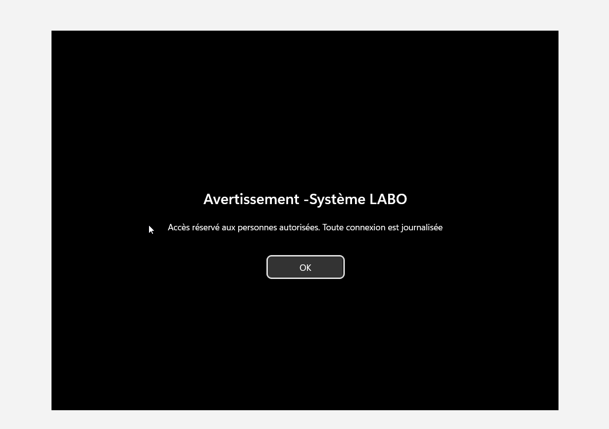
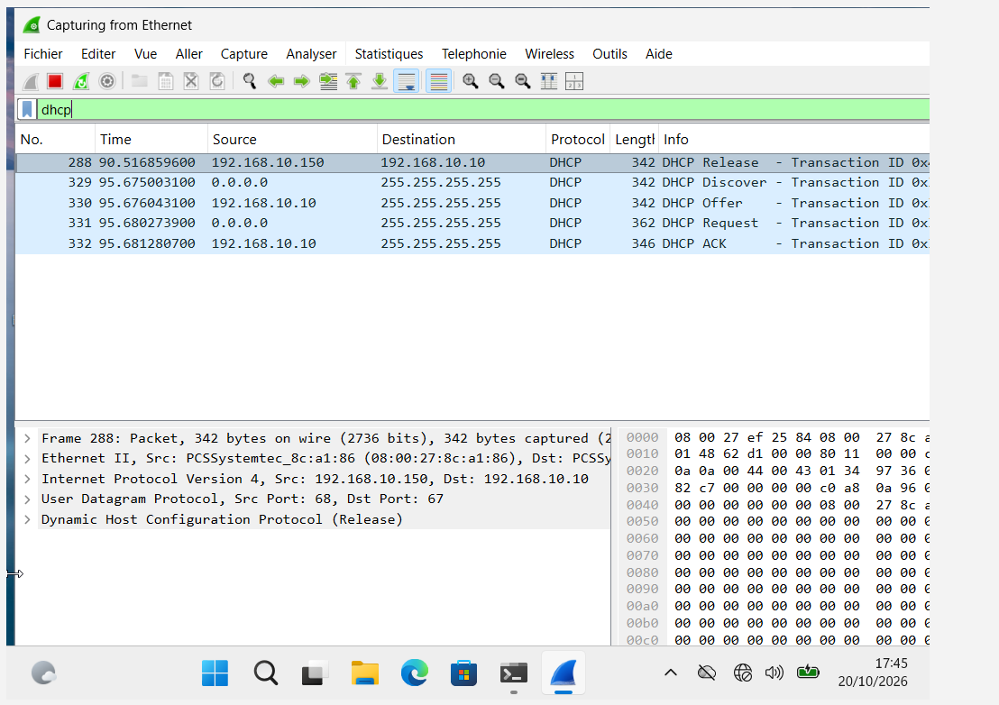
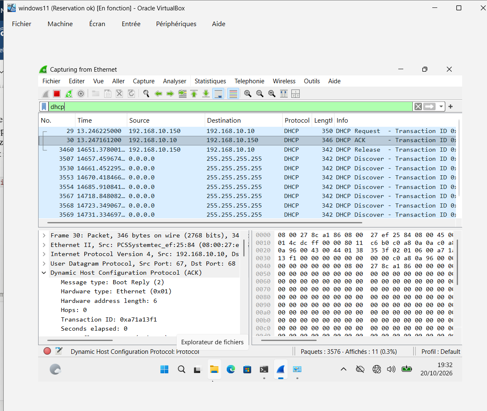
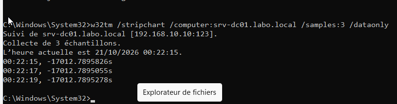

# Infrastructure Windows d'entreprise : Active Directory, DNS, DHCP et GPO


| | |
| --- | --- |
| **Auteur** | Wilfrid Nidol NGUIMDO, Master 2 Management de la Cybersécurité et du Cloud (IPSSI Montpellier) |
| **Période** | 19 → 21 octobre 2026 |
| **Type** | Projet personnel, laboratoire virtualisé (VirtualBox) |
| **Contact** | [LinkedIn](https://www.linkedin.com/in/wilfrid-nguimdo-780283336) |

---

## Synthèse

Ce projet reproduit le **socle d'identité et de réseau d'une PME** sous Windows : un contrôleur de domaine assurant les services Active Directory, DNS, DHCP et la référence horaire, et un poste client intégré au domaine et piloté par stratégie de groupe.

Au-delà du déploiement, il couvre **l'exploitation** :

- **9 incidents réels** rencontrés pendant la construction, chacun diagnostiqué et documenté ;
- **4 pannes provoquées volontairement** (DNS, DHCP, horloge/Kerberos, enregistrement DNS), avec diagnostic méthodique, preuves Wireshark et résolution ;
- une **vérification complète en PowerShell** de l'état final (21 contrôles).

Ce laboratoire sert de base au projet suivant : **détection d'attaques Active Directory avec Splunk (SOC)**.

## Résultats clés

| Indicateur | Résultat |
| --- | --- |
| Services déployés | AD DS, DNS (zones directe et inverse), DHCP, GPO, NTP |
| Poste intégré au domaine | PC-01, adresse réservée `192.168.10.150` |
| Négociation DHCP mesurée (DORA) | **6 ms** entre Discover et ACK |
| Décalage d'horloge détecté puis corrigé | **-17 012 s → -0,0001 s** |
| Incidents de construction résolus | **9 / 9** |
| Tests de résilience réalisés | **4 / 4** |

## Architecture

```
                 Réseau interne isolé « labnet » : 192.168.10.0/24
 ┌───────────────────────────────────┐              ┌───────────────────────────────────┐
 │ SRV-DC01 : Windows Server 2022    │              │ PC-01 : Windows 11 Entreprise     │
 │ 192.168.10.10 (IP fixe)           │◄────────────►│ 192.168.10.150 (réservation DHCP) │
 │ AD DS · DNS · DHCP · source NTP   │              │ membre du domaine labo.local      │
 └───────────────────────────────────┘              └───────────────────────────────────┘
          192.168.10.1 : passerelle réservée à un futur pare-feu (pfSense / OPNsense)
```

Détails et justification des choix : [docs/01-architecture.md](docs/01-architecture.md)

## Aperçu

| Bannière légale déployée par GPO sur PC-01 | Échange DHCP (DORA) mesuré dans Wireshark |
| --- | --- |
|  |  |

| Panne 2 : Discover sans réponse, service DHCP arrêté | Panne 3 : décalage d'horloge de -17 012 s mesuré |
| --- | --- |
|  |  |

## Documentation

| Document | Contenu |
| --- | --- |
| [01 – Architecture et choix techniques](docs/01-architecture.md) | Plan d'adressage, organisation AD, DNS, DHCP, GPO, choix justifiés |
| [02 – Procédure de déploiement](docs/02-procedure-deploiement.md) | Étapes de mise en œuvre, avec captures et scripts associés |
| [03 – Registre des incidents](docs/03-registre-incidents.md) | 9 incidents réels : symptôme, cause racine, correction |
| [04 – Tests de résilience](docs/04-tests-resilience.md) | 4 pannes provoquées, analysées et réparées, avec preuves Wireshark |
| [05 – Vérification PowerShell](docs/05-verification-powershell.md) | Contrôle de l'état final, script réutilisable |
| [06 – Fiche mémo](docs/06-fiche-memo.md) | Commandes, ports, événements Windows, méthode de dépannage |

## Compétences mobilisées

**Systèmes** : Windows Server 2022, Active Directory (forêt, OU, groupes, comptes à privilèges), GPO, Kerberos, synchronisation horaire W32Time.
**Réseau** : adressage IPv4, DHCP (étendue, exclusions, options, réservations, autorisation AD), DNS (A, SRV, PTR, SOA, mises à jour dynamiques sécurisées), ARP.
**Analyse et exploitation** : Wireshark, méthode de diagnostic couche par couche, PowerShell, documentation d'incidents.
**Sécurité** : comptes d'administration séparés (recommandation ANSSI), moindre privilège, bannière légale, protection contre les serveurs DHCP non autorisés, identification des événements à surveiller en SOC.

## Arborescence du dépôt

```
├── README.md
├── docs/            # documentation technique (6 documents)
├── screenshots/     # 52 captures d'écran, préfixées par le numéro du document qui les utilise
└── scripts/         # scripts PowerShell de déploiement et de vérification
```

## Suite du projet

1. **SOC avec Splunk** : collecte des journaux du DC et du poste (Universal Forwarder et Sysmon), simulation d'attaques dans le laboratoire isolé, règles de détection (4625, 4728, 4740, 4771, 7036…) cartographiées sur MITRE ATT&CK.
2. **Pare-feu pfSense/OPNsense** en `192.168.10.1` : accès Internet filtré et segmentation du laboratoire.
