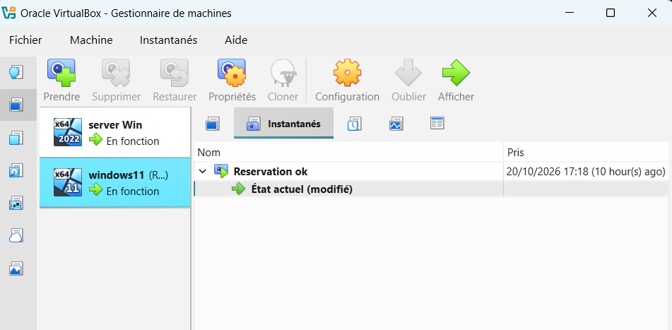

# 01 – Architecture et choix techniques

[← Retour au README](../README.md)

## Objectif

Reproduire le socle d'identité et de réseau d'une PME sous Windows. On le déploie, on le casse volontairement, puis on le diagnostique et on le répare, avec des preuves à chaque étape (Wireshark, commandes, PowerShell).

## Environnement

| Élément | Valeur |
| --- | --- |
| Hyperviseur | Oracle VirtualBox |
| Réseau | Réseau interne `labnet`, isolé d'Internet |
| Serveur | **SRV-DC01** : Windows Server 2022 Standard (expérience de bureau). Rôles : AD DS, DNS, DHCP, source de temps |
| Client | **PC-01** : Windows 11 Entreprise, membre du domaine |
| Domaine | `labo.local` (NetBIOS `LABO`), nouvelle forêt |

Les deux machines virtuelles tournent sous VirtualBox. Un **instantané** (« Reservation ok ») a été pris sur PC-01 une fois la configuration validée, avant les tests de panne : il permet de revenir à un état sain à tout moment.



```
           Réseau interne « labnet » : 192.168.10.0/24 (sans Internet)
 ┌──────────────────────────────┐          ┌──────────────────────────────┐
 │ SRV-DC01 – Windows Srv 2022  │◄────────►│ PC-01 – Windows 11 Entreprise│
 │ 192.168.10.10 (IP fixe)      │          │ 192.168.10.150 (réservation) │
 │ AD DS · DNS · DHCP · NTP     │          │ membre de labo.local         │
 └──────────────────────────────┘          └──────────────────────────────┘
        192.168.10.1 = passerelle réservée au pare-feu
```

## Plan d'adressage : 192.168.10.0/24

| Plage | Usage | Pourquoi |
| --- | --- | --- |
| `.0` / `.255` | Réseau / broadcast | Non attribuables |
| `.1` | Passerelle | Réservée au pare-feu (convention entreprise) |
| `.10` – `.49` | Serveurs, IP fixes | Adresses stables pour l'infrastructure |
| `.50` – `.99` | Équipements (imprimantes…) | Réserve pour des réservations |
| `.100` – `.109` | Exclues du DHCP | Marge pour des équipements configurés à la main |
| `.110` – `.200` | DHCP dynamique | Postes de travail |
| `.150` | Réservation de PC-01 | Poste toujours identifiable dans les journaux (SOC) |

Masque `255.255.255.0` · DNS `192.168.10.10` · suffixe DNS `labo.local`.

## Active Directory

```
labo.local
└── LABO
    ├── Utilisateurs-LABO   Alice Martin (alice.martin), Bob Durand (bob.durand),
    │                       Wilfrid Admin (wilfrid.admin → Admins du domaine)
    ├── Ordinateurs-LABO    PC-01
    └── Groupes-LABO        GG-Employes (sécurité, globale) = Alice + Bob
```

**Choix justifiés :**

- **OU dédiées** : les conteneurs `Users` et `Computers` ne peuvent pas recevoir de GPO.
- **Compte d'administration séparé** du compte quotidien, selon la recommandation de l'ANSSI.
- **La Default Domain Policy n'est jamais modifiée** : chaque besoin fait l'objet d'une GPO dédiée.
- **`redircmp`** : les postes joints au domaine arrivent directement dans `Ordinateurs-LABO`.

## DNS

- Zone directe `labo.local`, intégrée à l'AD, **mises à jour dynamiques sécurisées uniquement**.
- Zone inverse `10.168.192.in-addr.arpa`, qui contient les PTR (adresse → nom).
- Enregistrements SRV `_ldap._tcp.dc._msdcs.labo.local` (port 389), qui permettent aux postes de trouver le contrôleur de domaine.

## DHCP

| Élément | Valeur |
| --- | --- |
| Étendue | `192.168.10.100` – `.200`, exclusion `.100` – `.109` |
| Bail | 8 jours |
| Option 003, Routeur | `192.168.10.1`, définie au niveau de l'étendue |
| Option 006, DNS | `192.168.10.10` |
| Option 015, Domaine | `labo.local` |
| Réservation | PC-01, MAC `08-00-27-8C-A1-86` → `192.168.10.150` |
| Sécurité | Serveur autorisé dans l'AD, ce qui protège contre les faux serveurs DHCP (*rogue DHCP*) |

## GPO

| GPO | Liée à | Paramètres |
| --- | --- | --- |
| `GPO-Banniere-Connexion` | `Ordinateurs-LABO` | *Configuration ordinateur → Paramètres de sécurité → Stratégies locales → Options de sécurité*. Titre : « Avertissement – Système LABO ». Contenu : « Accès réservé aux personnes autorisées. Toute connexion est journalisée. » **Les deux sont obligatoires.** |

## Temps

SRV-DC01 est la source de temps fiable du domaine, au fuseau de Paris (`Romance Standard Time`). Kerberos tolère au maximum **5 minutes** d'écart entre client et contrôleur de domaine.
