# 02 – Procédure de déploiement

[← Retour au README](../README.md)

> Le déploiement a été réalisé via les consoles graphiques. Les scripts du dossier [`scripts/`](../scripts/) en sont l'équivalent PowerShell, écrit après coup : ils n'ont pas été exécutés de bout en bout sur ce lab. **Testez-les sur un snapshot** avant de vous en servir.

Chaque script se lance dans PowerShell **en administrateur**. Les mots de passe sont demandés à l'exécution et ne sont jamais écrits dans les scripts.

## Étape 1 – Préparation du serveur et création de la forêt (SRV-DC01)

Script : [`1-Install-DC.ps1`](../scripts/1-Install-DC.ps1) — en deux temps, le renommage redémarre la machine.

1. IP fixe `192.168.10.10/24`, passerelle `192.168.10.1`, DNS `127.0.0.1`.
2. Fuseau horaire Paris (`tzutil /s "Romance Standard Time"`).
3. Renommage en `SRV-DC01`, redémarrage.
4. Installation des rôles AD DS, DNS et DHCP.
5. Promotion en contrôleur de domaine d'une nouvelle forêt `labo.local` (NetBIOS `LABO`).

| Serveur préparé : nom `SRV-DC01`, IP fixe `192.168.10.10` | Rôles installés |
| --- | --- |
| 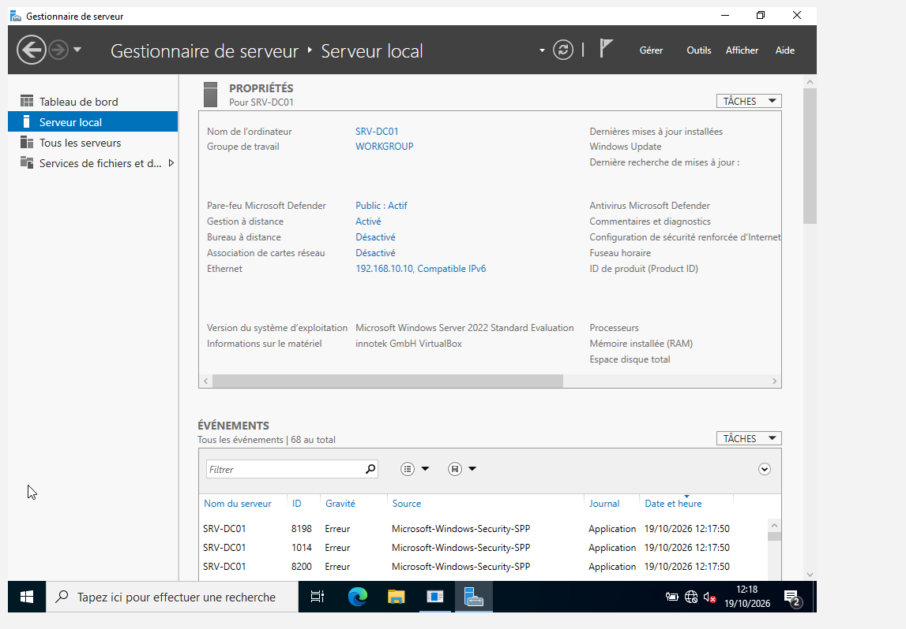 | 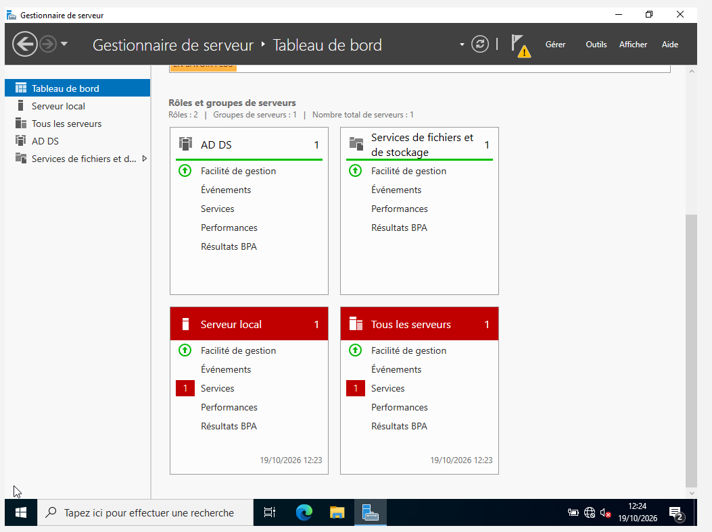 |

| Assistant AD DS : nouvelle forêt `labo.local` | Vérification de la configuration requise |
| --- | --- |
| 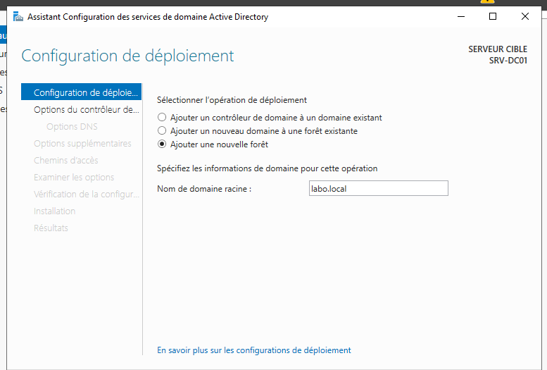 | 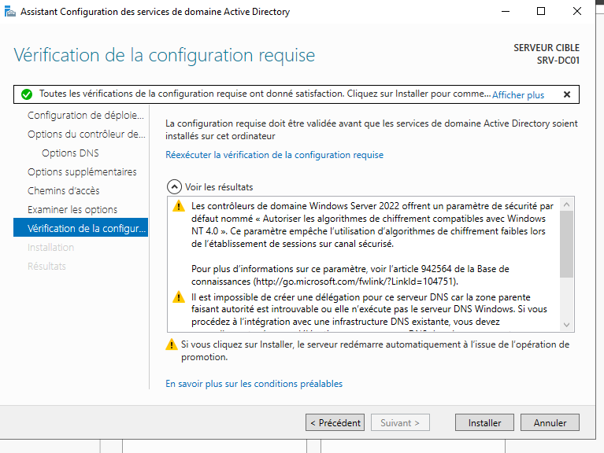 |

> L'avertissement sur la délégation DNS est normal pour une nouvelle forêt dont la zone parente (`local`) n'existe pas.

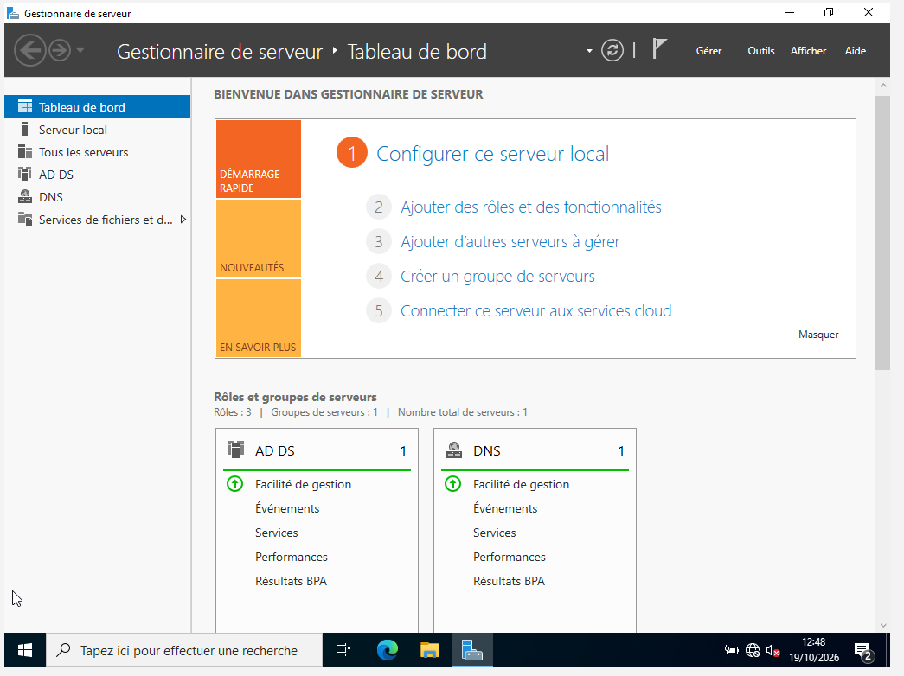

## Étape 2 – DNS, DHCP et temps (SRV-DC01)

Script : [`2-Config-Reseau.ps1`](../scripts/2-Config-Reseau.ps1)

1. Zone inverse `10.168.192.in-addr.arpa`, mises à jour sécurisées, puis `ipconfig /registerdns` pour créer le PTR du serveur.
2. Autorisation du serveur DHCP dans l'AD et création des groupes de sécurité DHCP.
3. Étendue `LAN-LABO` (`.100` – `.200`, bail 8 jours), exclusion `.100` – `.109`.
4. Options 003 / 006 / 015 **au niveau de l'étendue**.
5. Réservation de PC-01 en `.150`.
6. Le DC devient la source de temps fiable du domaine (`w32tm /config /reliable:yes`).

| Assistant de zone inverse | Zone `10.168.192.in-addr.arpa` créée |
| --- | --- |
| 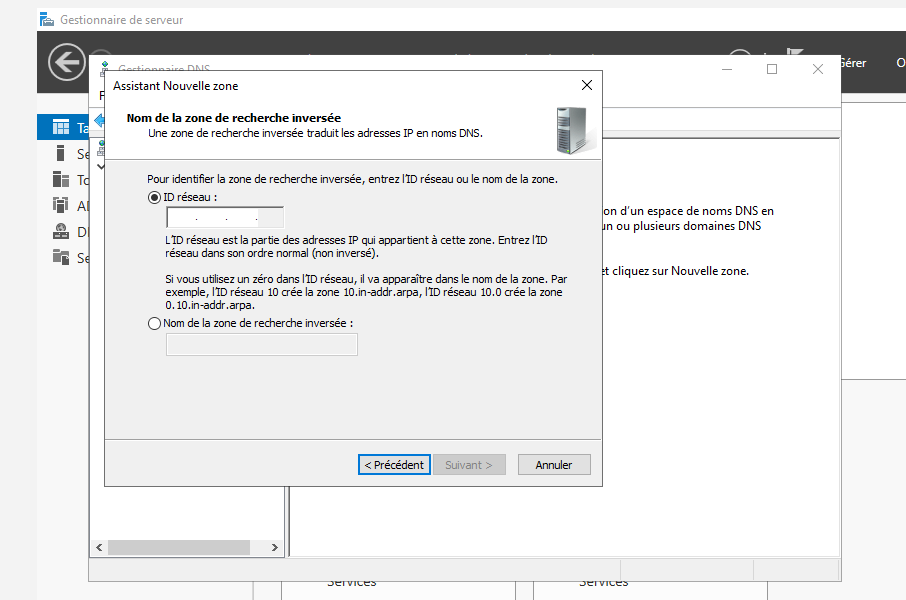 | 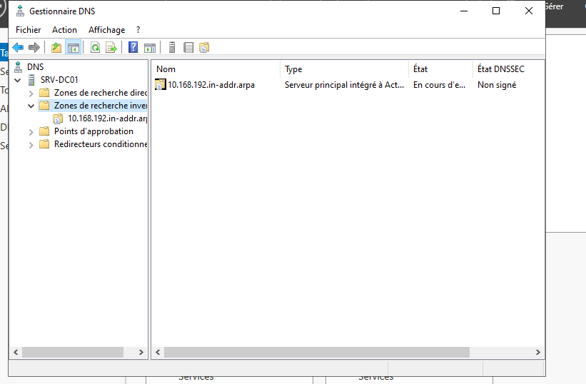 |

Vérification : l'enregistrement SRV `_ldap._tcp.dc._msdcs.labo.local` pointe bien vers `srv-dc01.labo.local` sur le port 389.

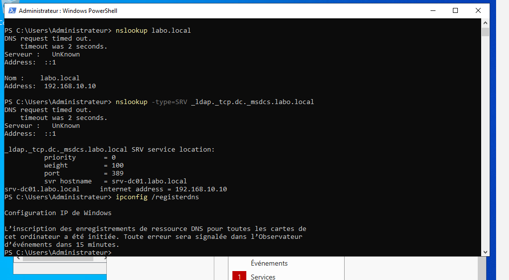

Preuve Wireshark : l'offre DHCP transporte bien les options 003 (routeur `192.168.10.1`), 006 (DNS `192.168.10.10`) et 015 (domaine `labo.local`).

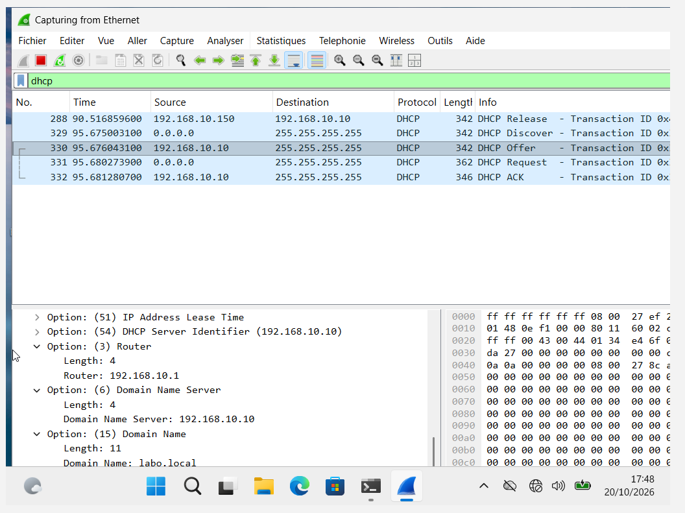

## Étape 3 – Annuaire et GPO (SRV-DC01)

Script : [`3-Config-AD-GPO.ps1`](../scripts/3-Config-AD-GPO.ps1)

1. OU `LABO` et ses sous-OU `Utilisateurs-LABO`, `Ordinateurs-LABO`, `Groupes-LABO`.
2. Redirection des nouveaux ordinateurs vers `Ordinateurs-LABO` (`redircmp`).
3. Comptes `alice.martin`, `bob.durand`, `wilfrid.admin`.
4. Groupe `GG-Employes` (Alice + Bob), `wilfrid.admin` dans *Admins du domaine*.
5. GPO `GPO-Banniere-Connexion` liée à `Ordinateurs-LABO`.

| Utilisateurs dans `Utilisateurs-LABO` | `wilfrid.admin` membre de *Admins du domaine* | Groupe `GG-Employes` |
| --- | --- | --- |
| 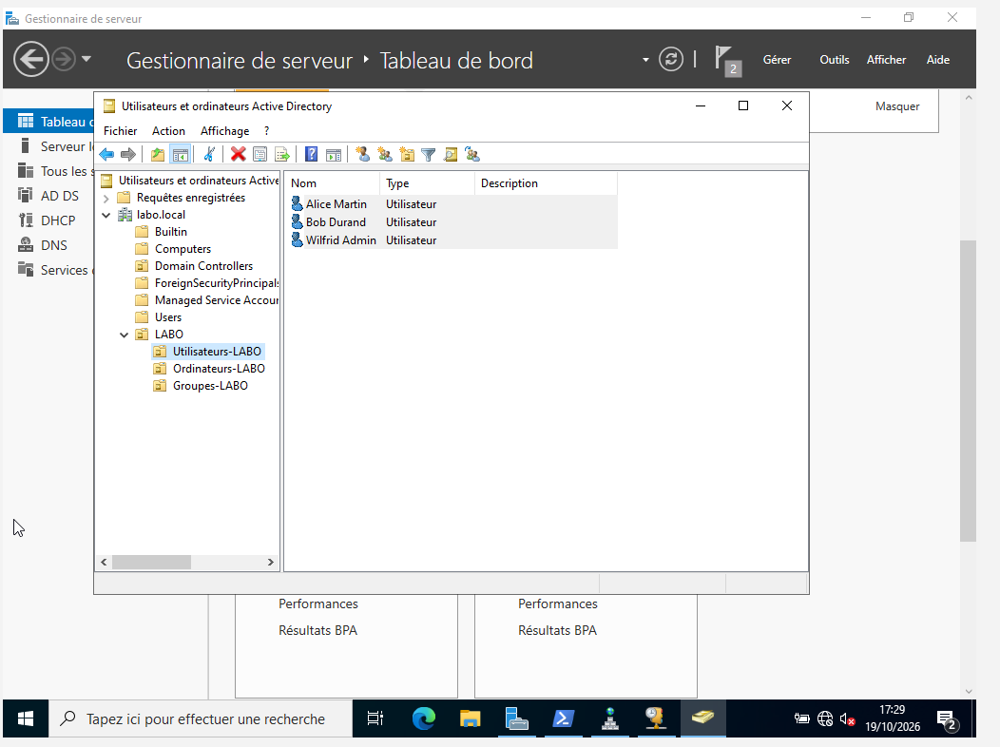 | 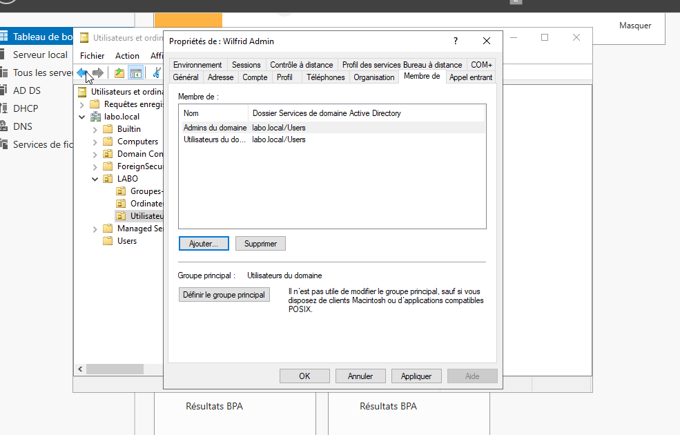 | 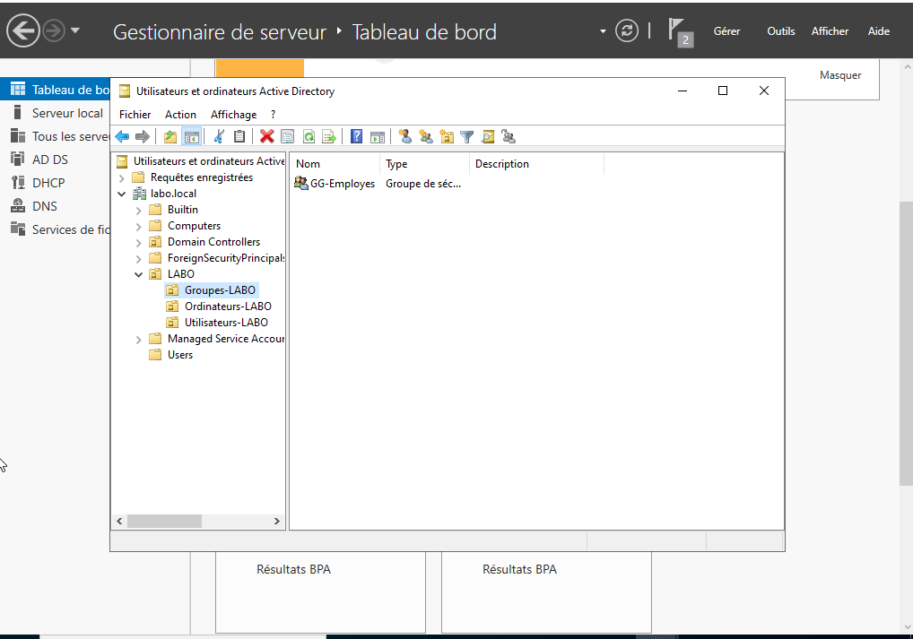 |

> Écrite en PowerShell, la GPO pose les deux mêmes valeurs de registre que l'option de sécurité configurée à la souris et produit le même effet sur PC-01. La différence : dans la console, elles apparaissent sous « Paramètres de registre supplémentaires » au lieu de « Options de sécurité ».

## Étape 4 – Intégration du poste (PC-01)

Script : [`4-Join-PC01.ps1`](../scripts/4-Join-PC01.ps1) — PC-01 doit avoir reçu son adresse et le DNS `192.168.10.10` par DHCP.

1. Fuseau horaire Paris, renommage en `PC-01`, redémarrage.
2. Jonction au domaine `labo.local` directement dans `Ordinateurs-LABO`, redémarrage.
3. Connexion en `LABO\alice.martin` : `whoami` → `labo\alice.martin`.
4. En invite administrateur : `gpupdate /force`, puis `gpresult /r /scope computer` → `GPO-Banniere-Connexion` appliquée.

| PC-01 rangé dans `Ordinateurs-LABO` | Ouverture de session en compte du domaine |
| --- | --- |
| 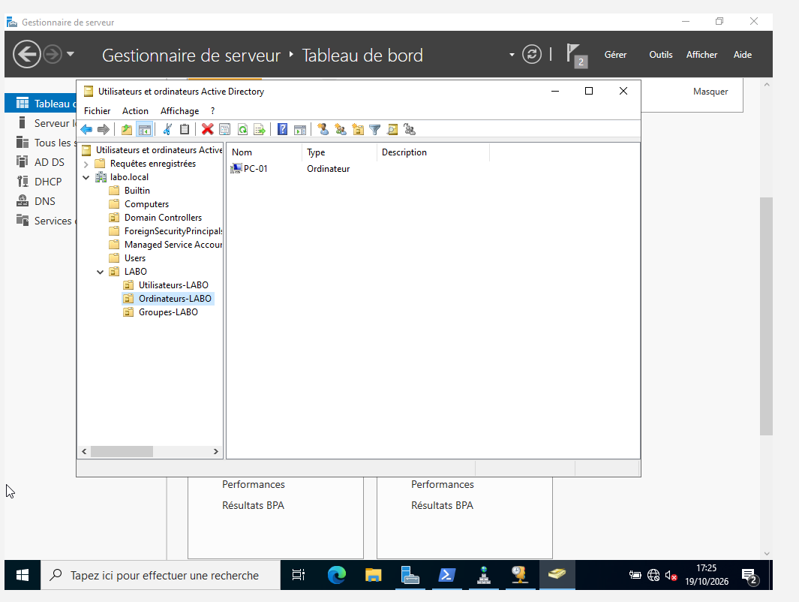 |  |

| `whoami` → `labo\alice.martin` | Bannière légale affichée avant l'ouverture de session |
| --- | --- |
| 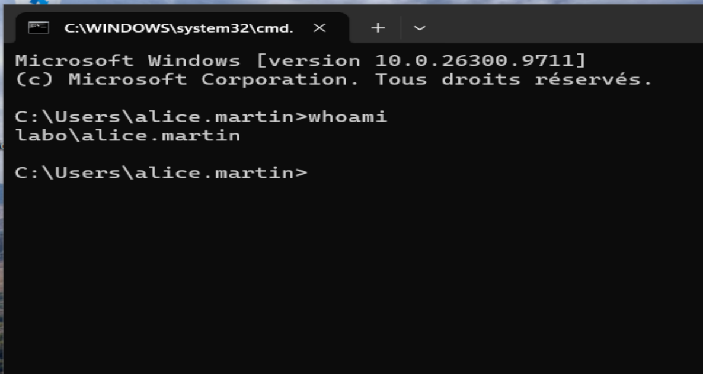 |  |

## Étape 5 – Vérification

Script : [`Test-LabInfrastructure.ps1`](../scripts/Test-LabInfrastructure.ps1) — voir [05 – Vérification PowerShell](05-verification-powershell.md).
