# 03 – Registre des incidents

[← Retour au README](../README.md)

Incidents **réels** rencontrés pendant la construction du lab (non provoqués). Chacun a été diagnostiqué et corrigé.

| # | Symptôme | Cause racine | Correction |
| --- | --- | --- | --- |
| 1 | Bannière de connexion absente | GPO jamais créée (tentative faite dans la mauvaise console) | Création et liaison dans `gpmc.msc` |
| 2 | Bannière toujours absente | Seul le contenu était défini, pas le titre | Ajout du titre : les deux valeurs sont obligatoires |
| 3 | `gpresult` → *Accès refusé* | Invite de commandes non élevée (UAC) | Ouverture en administrateur (`Ctrl + Maj + Entrée`) |
| 4 | Passerelle reçue : `198.168.10.1` | Faute de frappe dans l'option 003, définie au niveau serveur | Option recréée correctement au niveau de l'étendue |
| 5 | PC-01 reçoit `.100` | Plage d'exclusion non enregistrée | Exclusion `.100` – `.109` ajoutée |
| 6 | PC-01 reste en `.110` | Réservation non créée | Réservation créée, puis `ipconfig /release` et `/renew` |
| 7 | Mot de passe administrateur perdu | Oubli | Réinitialisation depuis le DC (événement **4724**) |
| 8 | Horloge du DC fausse | Fuseau et heure non réglés | `tzutil`, `Set-Date`, DC défini comme source de temps (`w32tm /config /reliable:yes`) |
| 9 | `nltest` → erreur **1212** | Espace manquant avant `/force` | Syntaxe corrigée : `nltest /dsgetdc:labo.local /force` |

## Preuves

### Incident 1 – Bannière absente : GPO jamais créée

La console *Utilisateurs et ordinateurs AD* ne permet pas de créer de GPO. Dans `gpmc.msc`, seules les deux stratégies par défaut existent, et `gpresult` confirme que PC-01 (bien rangé dans `Ordinateurs-LABO`) ne reçoit que la *Default Domain Policy*.

| Mauvaise console (aucune option GPO) | GPMC : aucune GPO personnalisée |
| --- | --- |
| 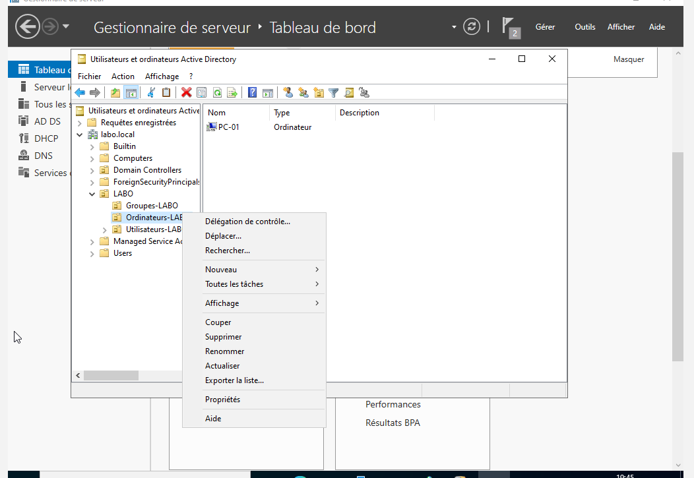 | 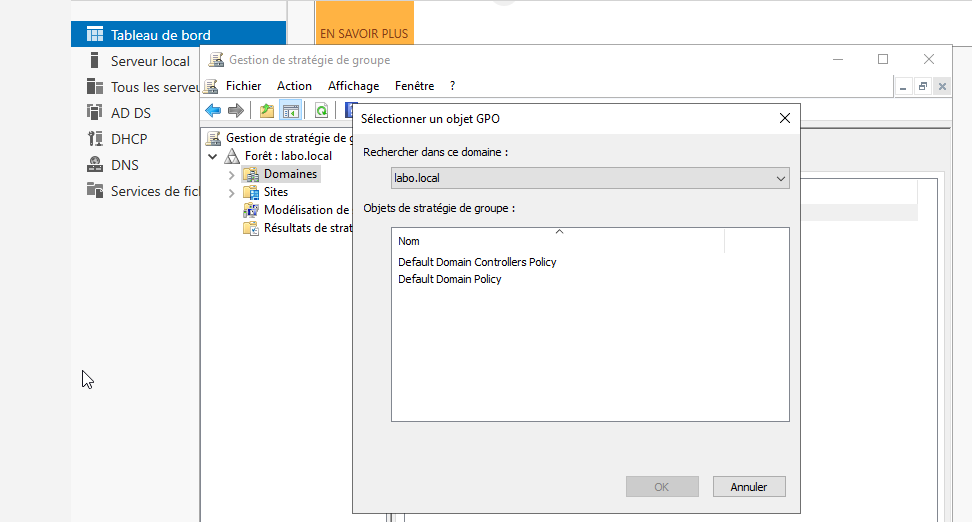 |

| `gpresult` : seule la Default Domain Policy | PC-01 bien placé dans l'OU ciblée |
| --- | --- |
| 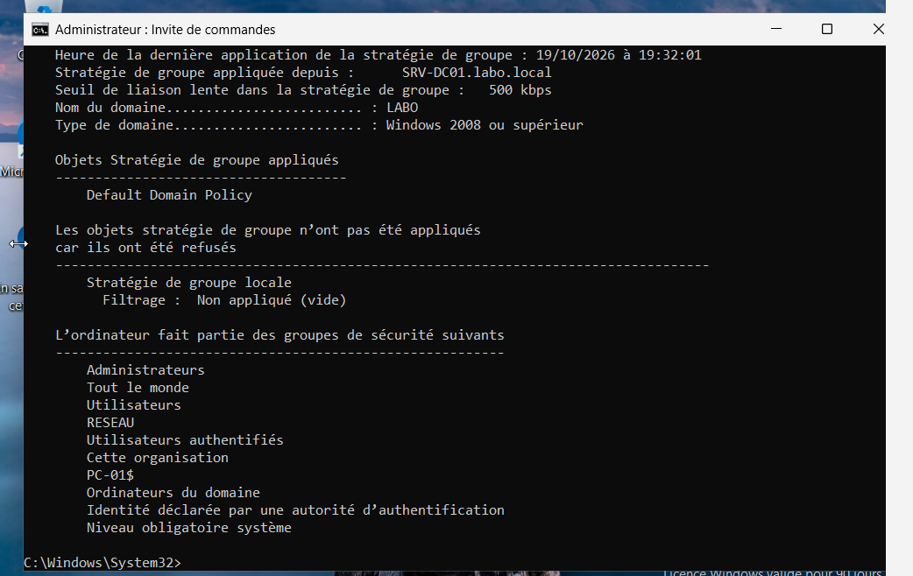 | 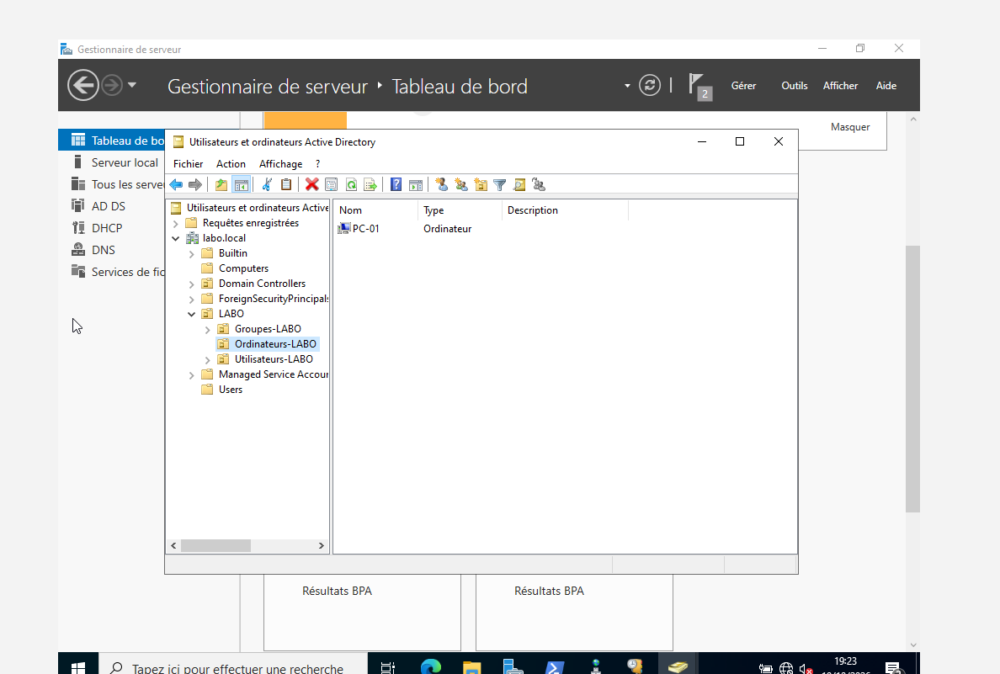 |

### Incident 2 – Bannière toujours absente : titre non défini

Le contenu du message est renseigné, mais le paramètre « titre du message » est resté *Non défini*.

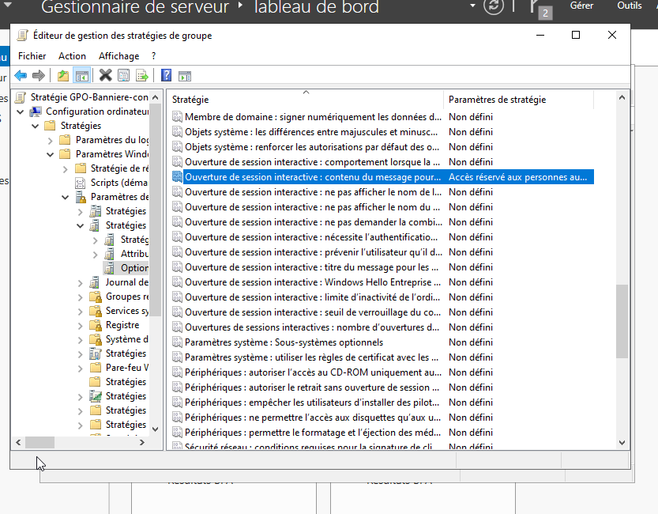

### Incident 3 – `gpresult` → Accès refusé

`gpupdate` fonctionne sans élévation, mais `gpresult /scope computer` exige une invite administrateur.

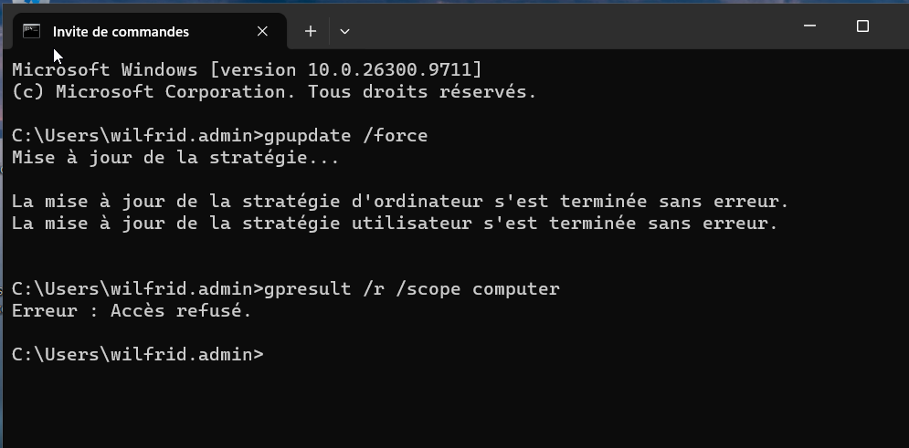

### Incidents 4 et 6 – Passerelle `198.168.10.1` et poste resté en `.110`

| Passerelle erronée reçue par PC-01 | Options d'étendue : 003 absente | Option 003 recréée au niveau de l'étendue |
| --- | --- | --- |
| 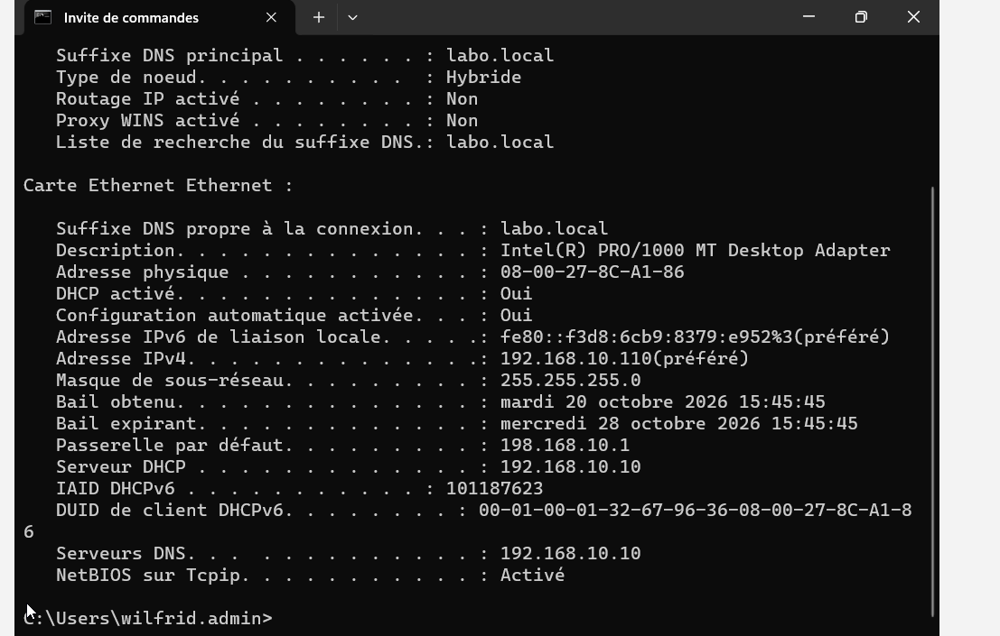 | 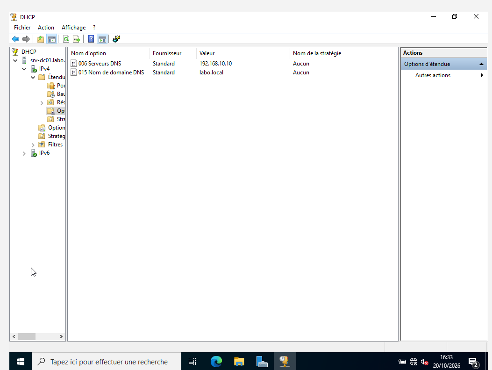 | 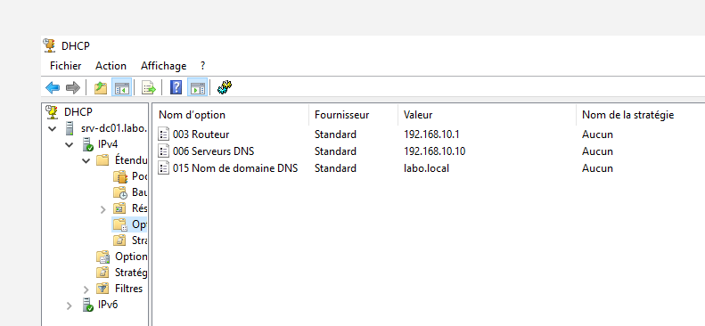 |

Après correction, la passerelle est bonne mais le poste est toujours en `.110` : la réservation n'existait pas encore.

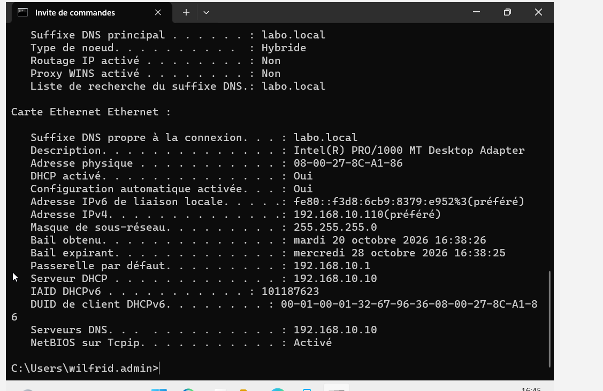

Une fois la réservation créée, `release` puis `renew` : échange DORA complet en **6 ms** (Discover à 95,675 s, ACK à 95,681 s).

### Incident 8 – Horloge du DC fausse

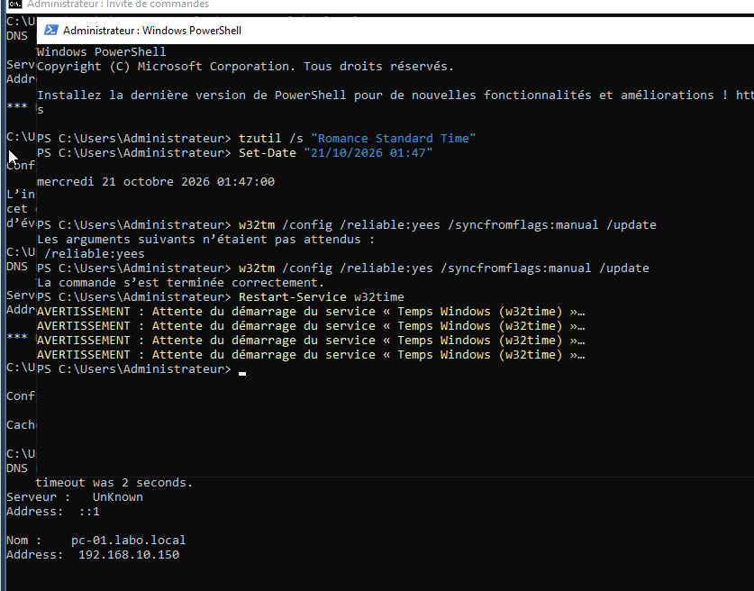

### Incident 9 – `nltest` → erreur 1212

Sans espace avant `/force`, la commande lit `labo.local/force` comme nom de domaine et renvoie `ERROR_INVALID_DOMAINNAME`.

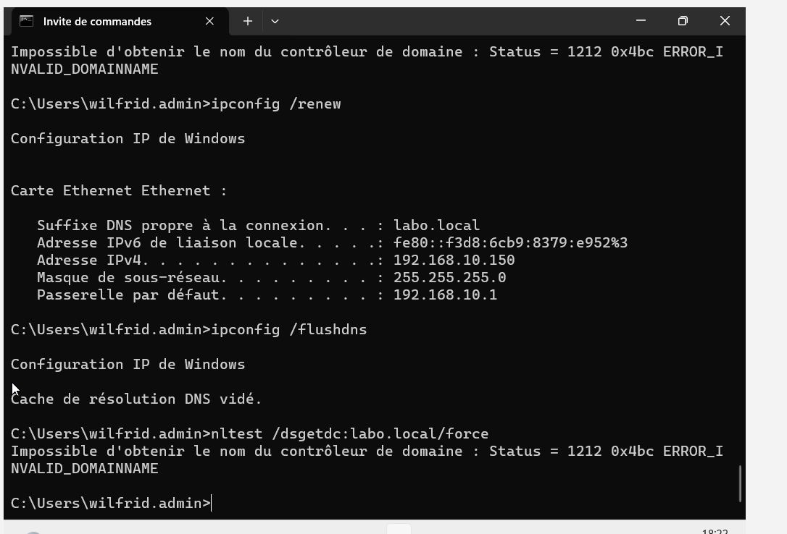

## Enseignements

- **Vérifier la portée** d'une option DHCP (serveur ou étendue) : une option de serveur s'applique à toutes les étendues et une faute de frappe s'y propage partout.
- **Une configuration non enregistrée n'existe pas** : toujours relire l'état réel (`Get-DhcpServerv4ExclusionRange`, `Get-DhcpServerv4Reservation`) après une modification.
- **Les outils de diagnostic ont leurs prérequis** : élévation pour `gpresult`, syntaxe stricte pour `nltest`.
- **L'heure du DC est critique** : elle conditionne Kerberos pour tout le domaine (voir [panne 3](04-tests-resilience.md#panne-3--décalage-dhorloge-et-kerberos)).
