# 04 – Tests de résilience : 4 pannes provoquées

[← Retour au README](../README.md)

## Méthode de diagnostic, couche par couche

| Étape | Question | Outil |
| --- | --- | --- |
| 1 | IP valide ? | `ipconfig /all` |
| 2 | Réseau joignable ? | `ping` |
| 3 | Noms résolus ? | `nslookup` |
| 4 | Contrôleur de domaine trouvé ? | `nltest /dsgetdc:labo.local /force` |
| 5 | Heure alignée ? | `w32tm /stripchart` |
| 6 | GPO reçues ? | `gpresult /r` |
| 7 | Preuve réseau | Wireshark |

## Synthèse

| Panne | Composant | Symptôme principal | Trace SOC |
| --- | --- | --- | --- |
| 1 | DNS client | Nom non résolu, DC introuvable (erreur 1212) | — |
| 2 | Service DHCP | Adresse APIPA `169.254.x.x` au renouvellement | Événement **7036** |
| 3 | Horloge / Kerberos | Aucun symptôme immédiat, écart de 4 h 43 mesuré | Événement **4771**, code `0x25` |
| 4 | Enregistrement DNS | `Non-existent domain` pour PC-01 | Événement **516** |

---

## Panne 1 : mauvais serveur DNS sur le poste

| | |
| --- | --- |
| **Action** | DNS de PC-01 forcé à `8.8.8.8` (`ncpa.cpl`, propriétés IPv4) |
| **Symptôme** | `ping 192.168.10.10` ✅, mais `nslookup srv-dc01.labo.local` ❌ (délai dépassé). Après `ipconfig /flushdns`, `nltest /dsgetdc:labo.local /force` ❌ avec l'erreur **1212** |
| **Diagnostic** | L'IP répond mais pas le nom : c'est le DNS. Wireshark ne montre **aucune requête DNS**, seulement des ARP `Who has 192.168.10.1?` sans réponse : pour joindre `8.8.8.8`, le poste cherche une passerelle qui n'existe pas. Le premier `nltest` avait réussi grâce au cache. |
| **Impact** | Contrôleur de domaine introuvable : plus de nouvelles authentifications Kerberos, de GPO ni de partages |
| **Correction** | DNS repassé en automatique, `ipconfig /flushdns`, puis `nltest /dsgetdc:labo.local /force` → `\\SRV-DC01.labo.local` |
| **Leçon** | En Active Directory, quand rien ne marche, regardez d'abord le DNS. |

**Preuves Wireshark**

| Avant : requêtes DNS normales vers `192.168.10.10` | Pendant : aucune requête DNS, seulement des ARP vers `.1` |
| --- | --- |
| 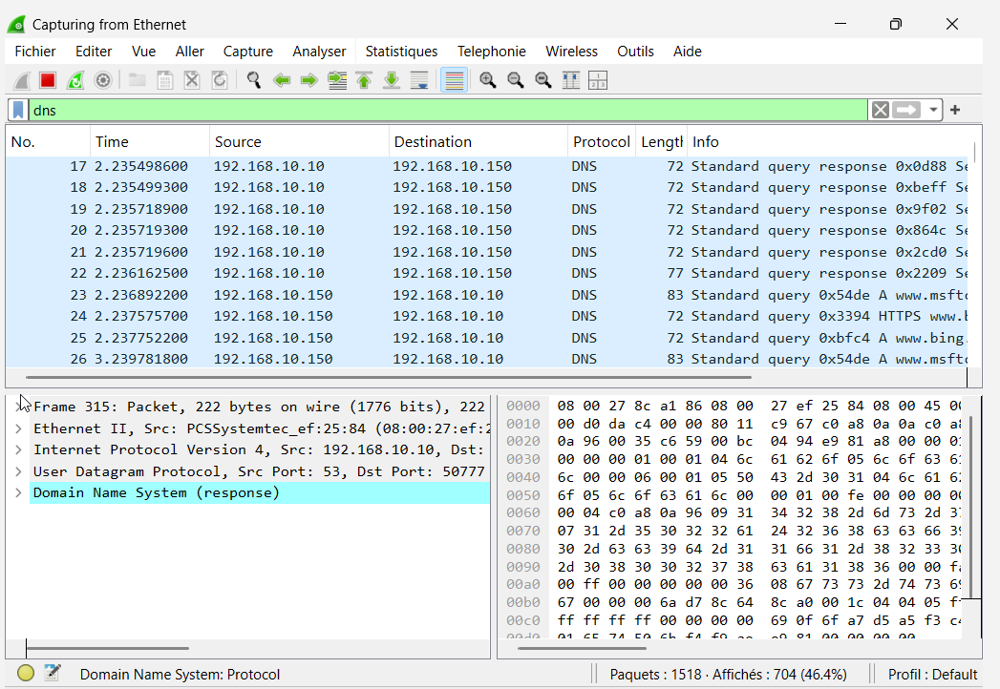 | 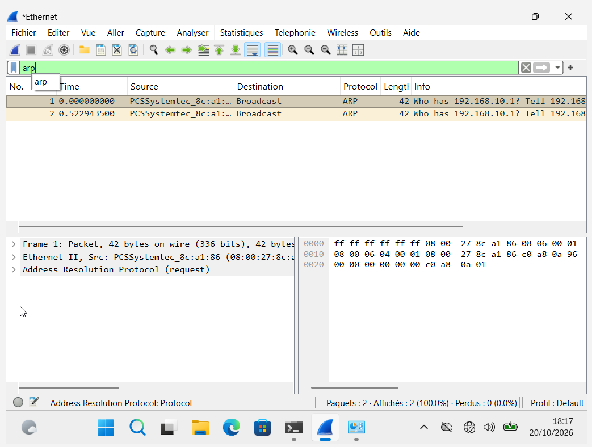 |

Après correction : le poste réinscrit sa fiche (*Dynamic update*), puis retrouve le contrôleur de domaine (requête SRV `_ldap._tcp`, puis A `srv-dc01`).

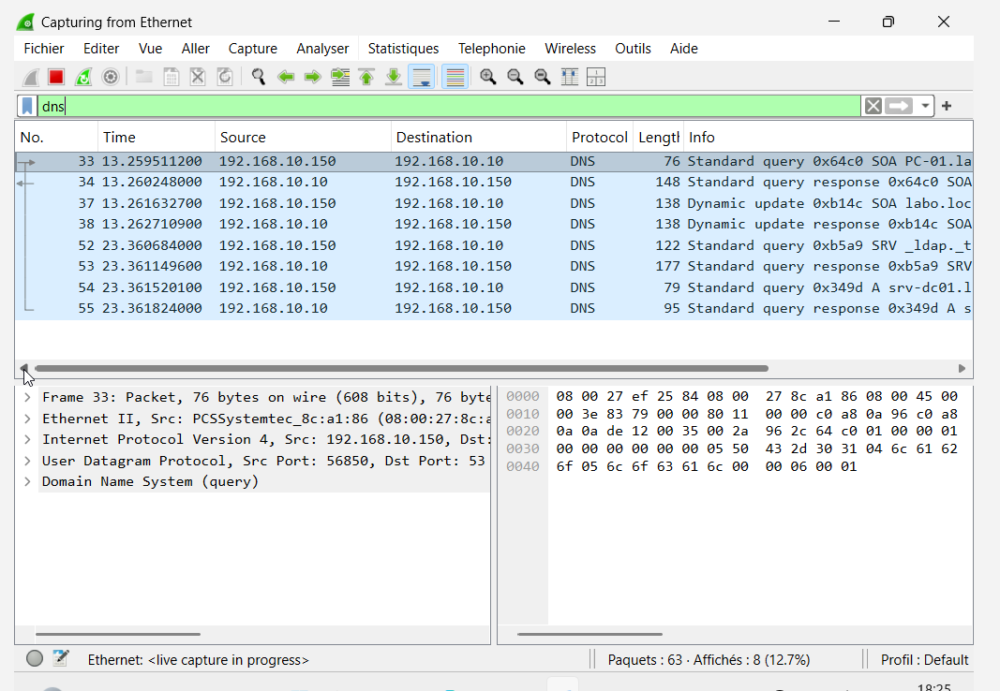

## Panne 2 : service DHCP arrêté

| | |
| --- | --- |
| **Action** | `net stop dhcpserver` sur SRV-DC01 |
| **Symptôme** | Rien au début : le bail de 8 jours est toujours valide. Après `ipconfig /release` puis `/renew`, PC-01 prend `169.254.221.9` (APIPA), masque `255.255.0.0`, sans passerelle |
| **Diagnostic** | Wireshark montre des **DHCP Discover répétés** à intervalles croissants (4 s, 9 s, 15 s, 33 s), sans aucune Offer. Une adresse `169.254` signifie qu'aucun serveur DHCP n'a répondu. |
| **Correction** | `net start dhcpserver`, puis `ipconfig /renew` sur PC-01 : **DORA complet en 6 ms**, retour en `.150` avec la passerelle `.1` |
| **Trace SOC** | Événement **7036** (service arrêté), journal Système |
| **Leçon** | Une panne DHCP est différée : elle n'apparaît qu'au démarrage ou au renouvellement des postes. |

**Preuves**

| Service arrêté puis redémarré sur SRV-DC01 | PC-01 en APIPA `169.254.221.9` |
| --- | --- |
| 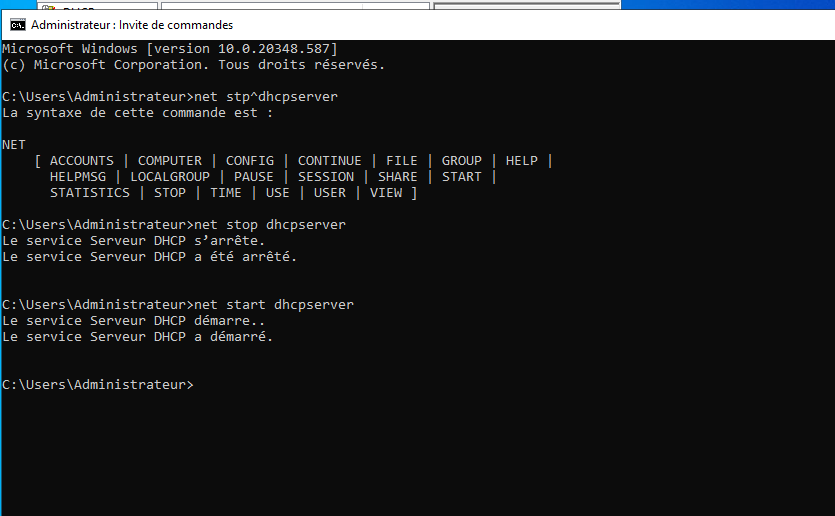 | 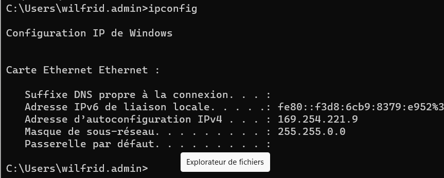 |

| Discover répétés, aucune Offer | Service relancé : Offer, Request, ACK |
| --- | --- |
|  | 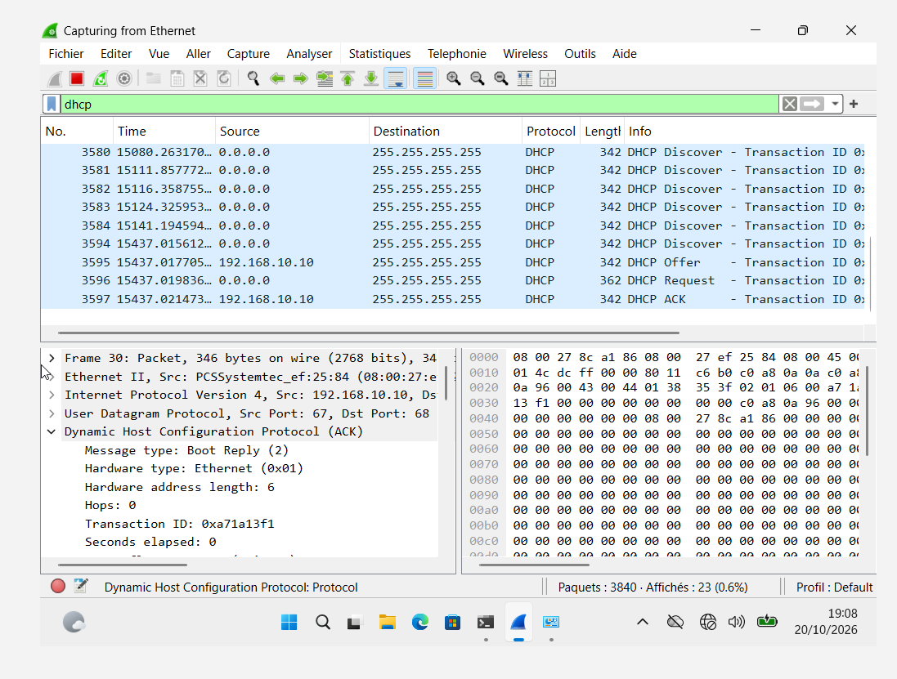 |

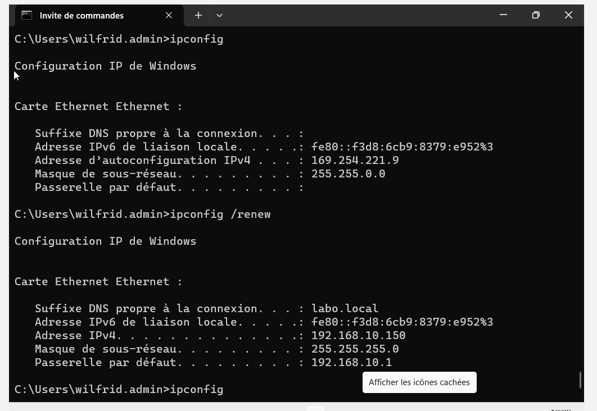

## Panne 3 : décalage d'horloge et Kerberos

| | |
| --- | --- |
| **Action** | Sur PC-01 : `net stop w32time`, `time 23:59`, `klist purge` et `klist purge -li 0x3e7` |
| **Symptôme** | Aucun : `gpupdate /force` réussit quand même |
| **Diagnostic** | Un test qui ne casse pas n'est pas une preuve, donc on mesure. `w32tm /stripchart /computer:srv-dc01.labo.local /samples:3 /dataonly` donne **-17 012 s** (≈ 4 h 43), bien au-delà des 5 minutes tolérées. `klist` montre que le TGT principal a été obtenu à 19:21, avant la panne, et reste valide jusqu'à 5:21 : la session continue grâce aux tickets en mémoire. |
| **Correction** | `net start w32time`, puis `w32tm /resync /force` : écart ramené à **-0,0001 s** |
| **Trace SOC** | Événement **4771**, code `0x25` (décalage d'horloge), journal Sécurité du DC |
| **Leçon** | Le blocage arrive au renouvellement des tickets, d'où les appels du type « hier ça marchait, ce matin plus rien ». Ce test a aussi révélé que l'horloge du serveur était fausse, corrigée avec `tzutil`, `Set-Date` et `w32tm /config /reliable:yes`. |

**Preuves**

| Panne provoquée, `gpupdate` réussit malgré tout | Purge des tickets (utilisateur et compte machine) |
| --- | --- |
| 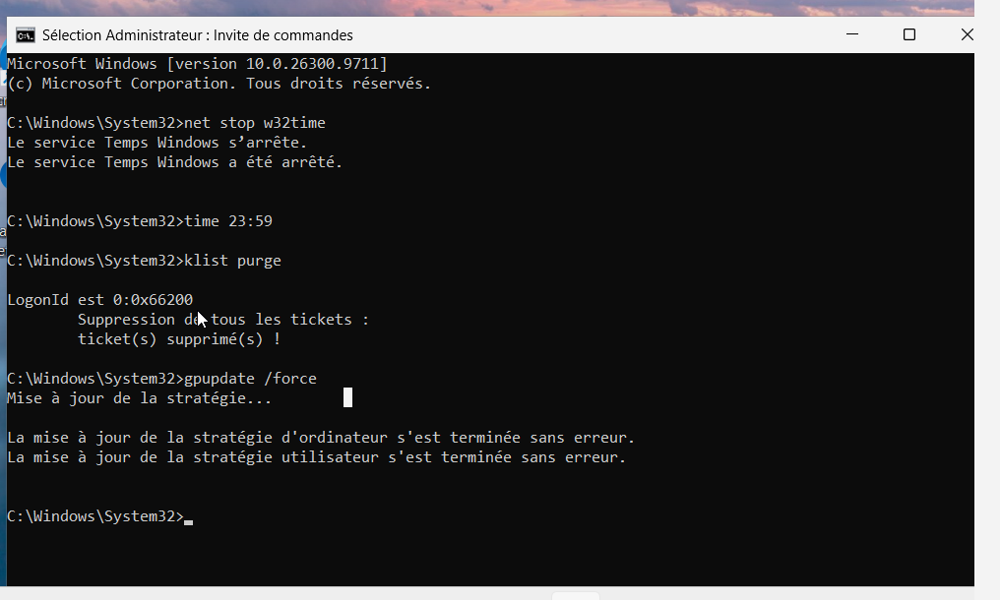 | 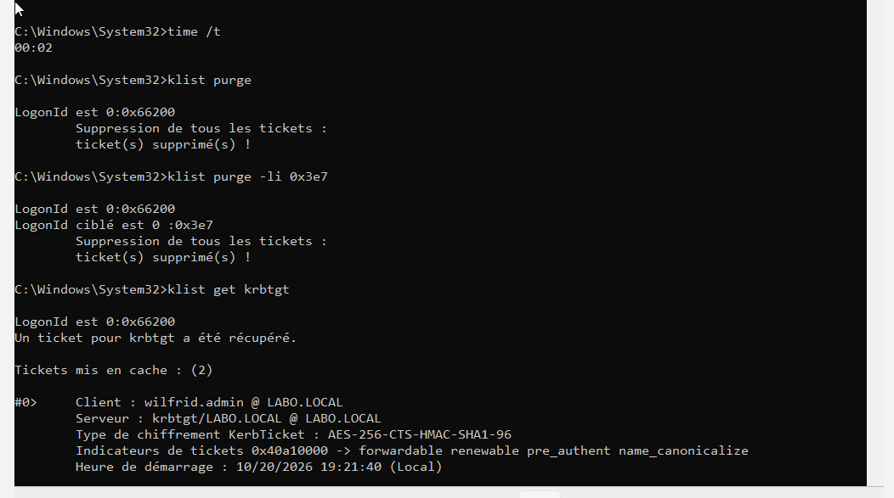 |

Le TGT obtenu à 19:21:40, avant la panne, reste valide jusqu'à 5:21:40 : la session continue sur les tickets en mémoire.

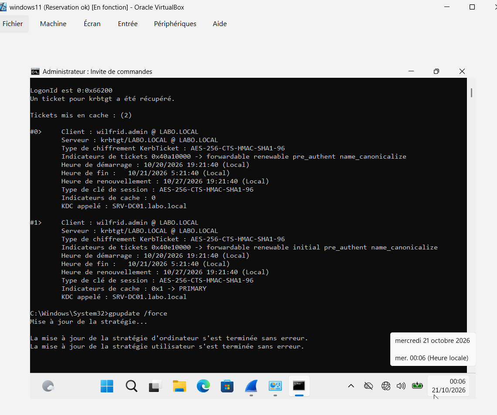

| Mesure : écart de -17 012 s | Correction : écart ramené à -0,0001 s |
| --- | --- |
|  | 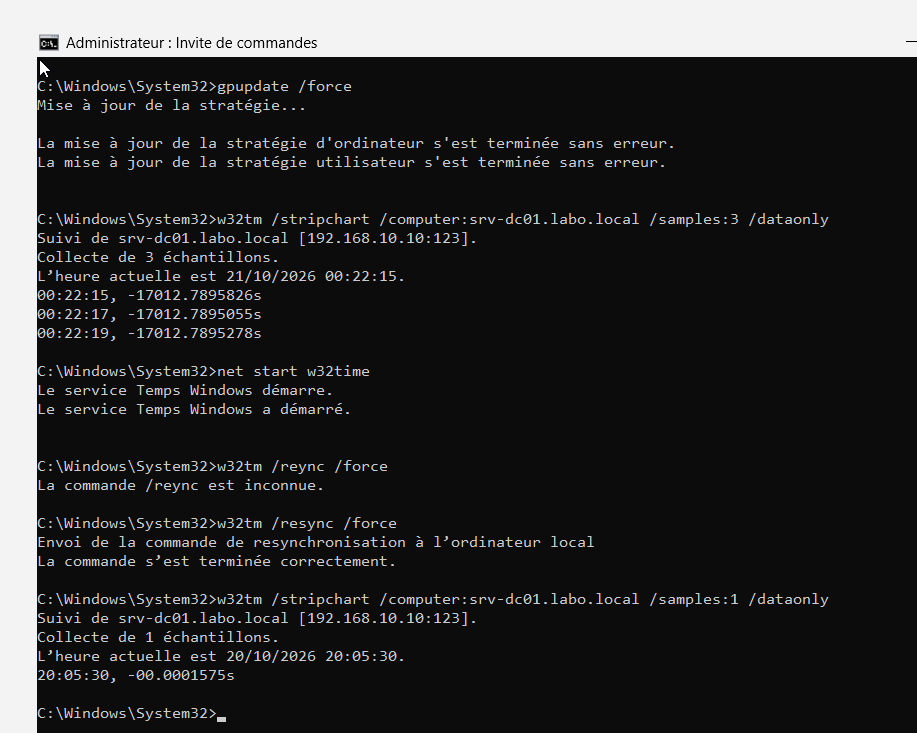 |

## Panne 4 : enregistrement DNS supprimé

| | |
| --- | --- |
| **Action** | Console DNS → zone `labo.local` → suppression de `PC-01 (A) 192.168.10.150` |
| **Symptôme** | Sur le serveur, `nslookup pc-01.labo.local` → `Non-existent domain`, alors que le poste fonctionne normalement |
| **Diagnostic** | La fiche a disparu de la zone DNS. Piège rencontré : `ipconfig /registerdns` lancé sur le serveur réinscrit le serveur, pas PC-01. |
| **Correction** | `ipconfig /registerdns` lancé **sur PC-01** : la fiche revient grâce à la mise à jour dynamique sécurisée |
| **Trace SOC** | Événement **516** (enregistrement supprimé), journal DNS Server / Audit |
| **Leçon** | Chaque machine gère sa propre fiche DNS : au démarrage, au renouvellement DHCP, puis toutes les 24 h. |

**Preuves**

Sur le serveur : après `ipconfig /flushdns`, `pc-01.labo.local` n'existe plus. Le `ipconfig /registerdns` lancé sur le serveur ne change rien (le piège).

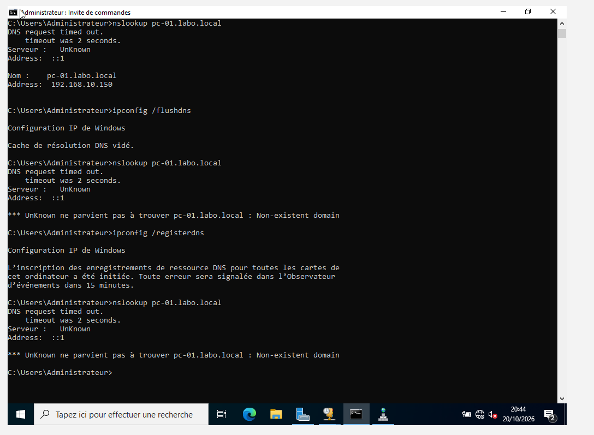

| `ipconfig /registerdns` lancé sur PC-01 | La fiche est revenue : `192.168.10.150` |
| --- | --- |
| 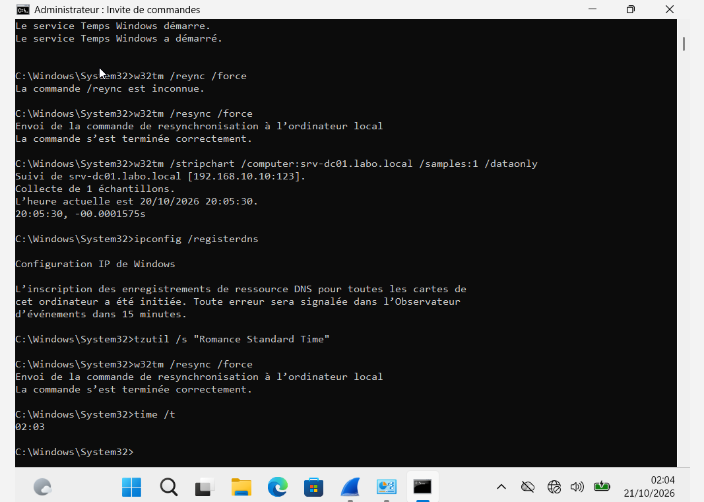 | 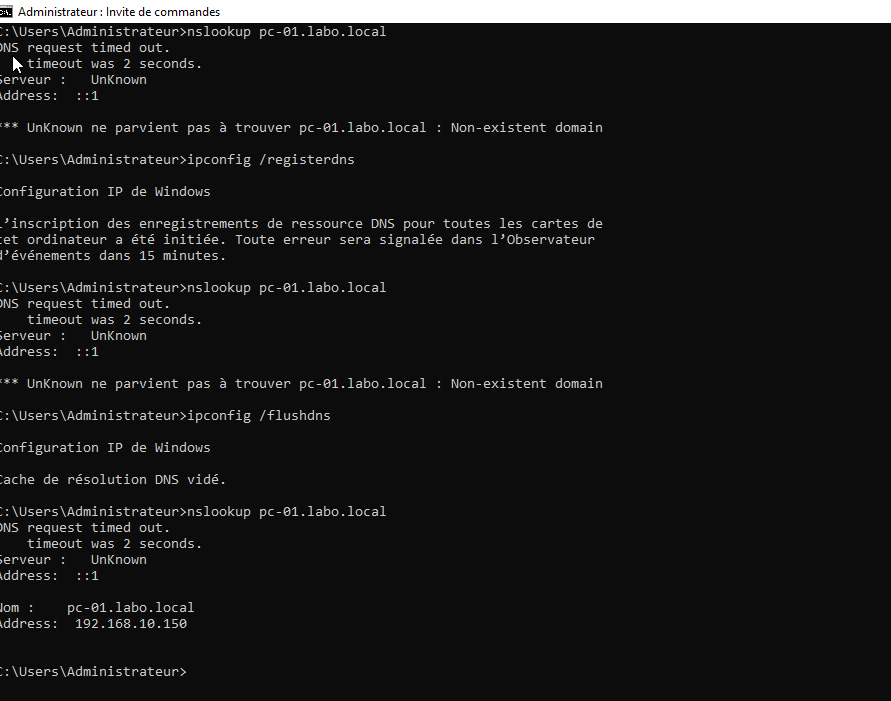 |
