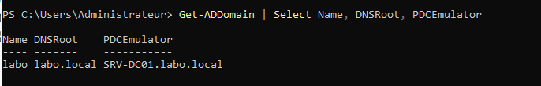
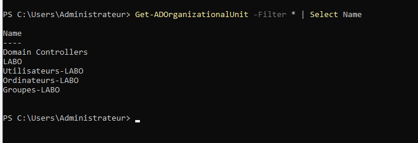
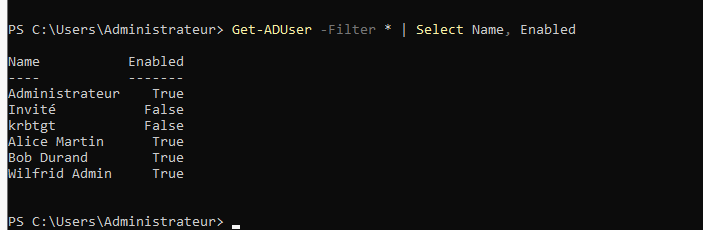
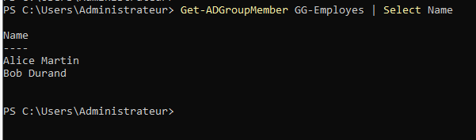
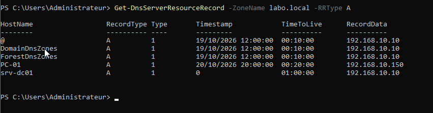
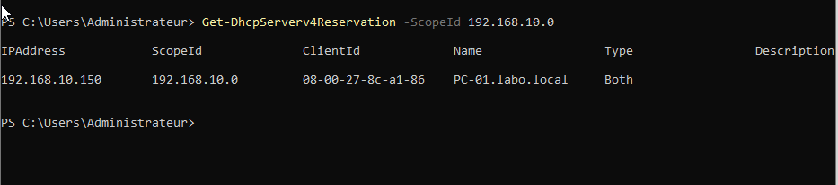
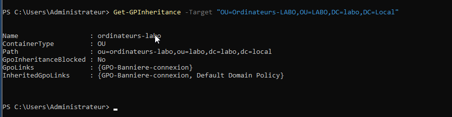

# 05 – Vérification PowerShell

[← Retour au README](../README.md)

Le script [`Test-LabInfrastructure.ps1`](../scripts/Test-LabInfrastructure.ps1) contrôle l'état final du lab. Il est **en lecture seule** : il n'effectue aucune modification.

## Exécution

Sur SRV-DC01, dans PowerShell en administrateur :

```powershell
Set-ExecutionPolicy -Scope Process Bypass
.\Test-LabInfrastructure.ps1
```

Chaque contrôle s'affiche en `[OK]` (vert) ou `[ECHEC]` (rouge), puis un bilan indique le nombre d'échecs.

## Les 21 contrôles

| Domaine | Contrôle |
| --- | --- |
| **Active Directory** | Domaine `labo.local` joignable |
| | OU `Ordinateurs-LABO` présente |
| | PC-01 dans `Ordinateurs-LABO` |
| | Groupe `GG-Employes` non vide |
| | Compte `krbtgt` désactivé (comportement normal) |
| | `wilfrid.admin` membre de *Admins du domaine* |
| **DNS** | Service DNS démarré |
| | Enregistrement A `srv-dc01` = `192.168.10.10` |
| | Enregistrement A `pc-01` = `192.168.10.150` |
| | Enregistrement SRV du contrôleur de domaine |
| | Zone inverse `10.168.192.in-addr.arpa` présente |
| **DHCP** | Service DHCP démarré |
| | Étendue active |
| | Option 003 = `192.168.10.1` |
| | Option 006 = `192.168.10.10` |
| | Réservation PC-01 = `192.168.10.150` |
| | Serveur DHCP autorisé dans l'AD |
| **GPO** | `GPO-Banniere-Connexion` existe |
| | `GPO-Banniere-Connexion` liée à `Ordinateurs-LABO` |
| **Temps** | Service de temps démarré |
| | Fuseau horaire Paris |

## Contrôles manuels réalisés sur le lab

| Domaine et contrôleur (PDC) | Unités d'organisation |
| --- | --- |
|  |  |

| Comptes (`krbtgt` et Invité désactivés) | Membres de `GG-Employes` |
| --- | --- |
|  |  |

| Enregistrements A de la zone `labo.local` | Réservation DHCP de PC-01 |
| --- | --- |
|  |  |

GPO liée à `Ordinateurs-LABO` :



## Réutilisation

Les paramètres (domaine, zone, étendue, adresses, OU, GPO, groupe) sont regroupés en tête du script : il suffit de les adapter pour vérifier un autre environnement. Le script peut aussi servir de **contrôle de non-régression** après chaque panne provoquée ([04 – Tests de résilience](04-tests-resilience.md)).
